# SmartBank AI: Architecture and Approach

## 1. Goal and scope

The brief asks for a working application that shows **multiple AI agents cooperating in a simulated
real-time banking environment**: a supervisor that routes requests, at least three specialist agents,
simulated banking APIs, LLM-driven natural language, 3-5 use cases and a usable interface.

The reference diagram describes a nine-layer production platform. Rather than mocking all nine layers
superficially, SmartBank AI implements a **thin but real slice of each layer that matters for the
agent story**, and every slice is exercised by the demo use cases and covered by tests.

| Reference layer | Implemented as |
|---|---|
| 1. Banking channels | React web app (login, dashboard, assistant), responsive down to phone width |
| 2. API & experience | FastAPI: JWT auth, Pydantic request validation, per-user rate limiting, correlation/trace id, CORS |
| 3. AI gateway / control plane | Guardrails node (PII masking, prompt-injection block), model selection via config, audit log, human-in-the-loop |
| 4. Multi-agent orchestrator | LangGraph state machine: Supervisor → specialists → approval → aggregator, with a checkpointer |
| 5. Agent tool layer | Per-agent tool registries (permission boundary), confirmation-gated sensitive tools, tool-call audit |
| 6. Enterprise data | SQLite via SQLAlchemy: customers (CRM), accounts, cards, transactions, loans, credit bureau, alerts |
| 7. Knowledge / RAG | Policy documents → section chunks → Gemini embeddings (Chroma) + BM25 → reciprocal rank fusion |
| 8. External services | Simulated credit bureau and payment switch (live transaction simulator) |
| 9. Cross-cutting platform | LangSmith tracing, in-app Agent Trace, audit table, health endpoint, test suite, Docker |

Deliberately **out of scope**: real payment rails, OAuth/OIDC with an identity provider, multi-channel
notifications (SMS/email), and model training. Each is listed under *Future work*.

---

## 2. High-level design

```
 ┌──────────────────────────── React (Vite + Tailwind) ────────────────────────────┐
 │  Login │ Dashboard + live feed │ Assistant chat │ Agent Trace │ Confirm dialog    │
 └───────────┬──────────────────────────┬───────────────────────────┬──────────────┘
        REST + JWT              SSE (chat stream)             WebSocket (/ws)
             │                          │                           ▲
 ┌───────────▼──────────────────────────▼───────────┐               │ push
 │ FastAPI  — auth · validation · rate limit · trace id            │
 │                                                  │     ┌─────────┴─────────┐
 │   LangGraph workflow (per user thread)           │     │ Realtime hub      │
 │   guardrail → supervisor → [dispatch] → agents   │     │ + txn simulator   │
 │             → approval (interrupt) → aggregate   │     └─────────┬─────────┘
 └──────┬───────────────────────────────┬──────────┘               │
        │ tools (per-agent)             │ checkpoints              │
 ┌──────▼───────────────────────┐  ┌────▼─────────────┐            │
 │ services/banking.py          │◄─┤ SQLite / Postgres│◄───────────┘
 │ fraud_rules.py, loan_rules.py│  └──────────────────┘
 └──────┬───────────────────────┘
        │ RAG
 ┌──────▼──────────────┐      Gemini (chat + embeddings)   LangSmith (traces, evals)
 │ Chroma + BM25 (RRF) │
 └─────────────────────┘
```

### The LangGraph workflow (`backend/app/agents/graph.py`)

```mermaid
flowchart TD
    START([START]) --> guardrail[Guardrail<br/>mask PII, block injection]
    guardrail -- blocked --> aggregate
    guardrail --> supervisor[Supervisor · Gemini<br/>intent + ordered agent plan]
    supervisor --> dispatch{Dispatch}
    dispatch -- next agent in plan --> customer[Customer agent]
    dispatch -- next agent in plan --> fraud[Fraud & Risk agent]
    dispatch -- next agent in plan --> credit[Credit & Loan agent]
    dispatch -- next agent in plan --> compliance[Compliance agent · RAG]
    customer & fraud & credit & compliance -- no sensitive action --> dispatch
    fraud & credit -- sensitive tool requested --> approval[[Approval · interrupt&#40;&#41;<br/>waits for Confirm / Cancel]]
    approval --> dispatch
    dispatch -- plan finished --> aggregate[Aggregate<br/>1 answer passes through · 2+ merged by Gemini]
    aggregate --> END([END])
```



`Dispatch` is a conditional edge, not a node. The SQLite checkpointer saves the state after every node, which gives conversation memory and lets the approval step pause and resume.

**Single source of truth.** The REST endpoints that render the dashboard, the agents' tools and the
real-time simulator all call the same functions in `services/banking.py`. The assistant can therefore
never contradict what the dashboard shows.

---

## 3. The life of one request

*"I don't recognise the charges from Dubai."* (customer: Arjun)

1. **API.** `POST /api/chat` checks the JWT, applies the rate limit, assigns a trace id and opens a
   Server-Sent-Events stream. The LangGraph thread id is `user{id}:{conversation}`, so users can never
   read or resume each other's conversations.
2. **Guardrail node.** Masks PII such as card numbers, phone numbers and OTPs, replacing the message
   in memory so raw PII never reaches the LLM, LangSmith or the checkpoint. It blocks injection
   attempts without calling the LLM at all.
3. **Supervisor node.** Gemini receives the agent catalogue and the recent conversation and must return
   a `RouteDecision` (Pydantic schema): `intent`, ordered `steps[{agent, task}]`, optional
   `direct_response`, and `reasoning`. Here the result is `fraud_check → [fraud]`.
4. **Dispatch.** A conditional edge pops the next step from the queue and sends the state to that
   agent's node. When the queue is empty it goes to the aggregator.
5. **Fraud agent (ReAct loop).** Gemini, bound to *only* the fraud tools, calls
   `scan_suspicious_transactions` and gets back four HIGH-risk transactions with rule-engine scores
   and reasons. It then calls `block_card`.
6. **Confirmation gate.** `block_card` is marked `requires_confirmation`, so the agent loop does **not**
   execute it. It records a `pending_action` and tells the model the action is awaiting the customer.
7. **Approval node.** `interrupt()` persists the state and stops the graph. The API streams a
   `confirmation` event and the UI shows *"Block your RuPay debit card XXXX 4872. Confirm / Cancel"*.
8. **Resume.** `POST /api/chat/confirm` sends `Command(resume={"approved": true})`. The approval node
   executes the tool, writes an audit row, and appends "✅ Done - your card is blocked".
9. **Aggregator.** One agent means its answer passes through with no extra LLM call. Several agents
   means Gemini merges their answers under a "don't add facts, keep every number" instruction.
10. **Side effects.** The card is now `BLOCKED`. The next simulated card transaction is **declined**
    and the customer sees it live on the dashboard.

Every step above emits a trace item that the UI renders live, and LangSmith records the same run with
token counts and latencies.

---

## 4. Key design decisions

### 4.1 Supervisor pattern (router + specialists) instead of one big agent
- **Accuracy:** small prompts and 2-5 tools per agent give more reliable tool selection than one
  agent with 15+ tools.
- **Least privilege:** each agent is built with only its own tools. The Customer Agent *cannot* block
  a card, and a test asserts this.
- **Extensibility:** adding an agent means one `AgentSpec` (prompt + tool factory) and one entry in
  the supervisor's `Literal` type.
- **Cost:** a single-agent answer skips the aggregation LLM call.

### 4.2 No model training: zero-shot routing with structured output
Intent classification uses Gemini with a Pydantic schema instead of a trained classifier. A trained
model would need a labelled banking-intent dataset and retraining whenever an agent is added, while an
LLM handles paraphrases, typos and multi-intent messages out of the box. Robustness comes from:
schema validation; post-processing (de-duplicate steps, cap at 3); a **deterministic keyword
fallback** when the LLM call fails; and **measurement** of routing accuracy with the labelled dataset
in `evals/` via LangSmith.

### 4.3 "The LLM explains, code decides"
Fraud risk scores (`fraud_rules.py`) and loan eligibility, interest rate, EMI and FOIR
(`loan_rules.py`) are deterministic, unit-tested Python. The LLM **never** produces a number on its
own: agents must fetch every figure through tools. This makes decisions reproducible, auditable and
explainable, which is what a regulator expects, and stops hallucinated balances or approvals. In a
production bank `fraud_rules.py` would be replaced by an ML model (e.g. gradient-boosted trees on
labelled fraud data) behind the same interface: features in, score and reasons out.

### 4.4 Human-in-the-loop with LangGraph `interrupt()`
Money-moving or account-changing actions (`block_card`, `apply_for_loan`) go through an approval
node. Because the checkpointer persists the paused state, the confirmation survives a page reload or
server restart, and a new chat message is refused (HTTP 409) until the action is answered.

### 4.5 Security by construction
- `customer_id` is captured in a closure when the tools are built from the **authenticated session**.
  It is never a tool argument, so prompt injection cannot redirect a tool to another customer.
- Guardrails mask PII *before* the LLM and block common injection patterns *without* an LLM call.
- Account numbers and phone numbers are masked in every API and tool response.
- Passwords use bcrypt; sessions use signed JWTs; the JWT secret is random when not configured.
- The container runs as a non-root user; secrets live only in `.env` (gitignored) or a secret manager.

### 4.6 Hybrid RAG for policy questions
Policies are chunked **by section** (`## heading`), because policy text is organised by topic and a
section is a self-contained rule. Retrieval fuses **semantic search** (Gemini embeddings in Chroma)
with **BM25 keyword search** using reciprocal rank fusion (`1/(60+rank)`). BM25 catches exact terms
like "FOIR" and "NACH", embeddings catch paraphrases like "close my loan early" → *foreclosure*.
Without embeddings (no key or quota exhausted) the retriever degrades to BM25-only. The Compliance
agent must answer only from retrieved text and cite `Document › Section`.

### 4.7 Not everything is an agent
Notifications are a deterministic service: alerts are created by the transaction pipeline and pushed
over WebSocket. Using an LLM there would add latency, cost and non-determinism for no benefit.

### 4.8 Real-time transport choices
- **SSE** for chat: one-way server → client streaming over plain HTTP, ideal for "here is the next
  agent step".
- **WebSocket** for the live feed: a long-lived channel the server can push to at any time.
- The simulator only generates traffic for customers who are online, keeping the demo data clean.

---

## 5. Data model

`users` (login) → `customers` (CRM / KYC) → `accounts`, `cards`, `loans`, `credit_reports`;
`transactions` (with `risk_score`, `risk_level`, `risk_reasons`, `status`); `alerts`; `audit_log`
(trace id, event, JSON details). Seed data creates four customers whose profiles exercise different
code paths (approve / conditional / KYC-blocked / fraud).

## 6. Testing strategy
- **Unit:** fraud rules, loan rules (EMI formula against a textbook value, FOIR, hard stops), guardrails.
- **Routing:** supervisor with a stub LLM, fallback on LLM failure, de-duplication.
- **Workflow:** the full LangGraph graph with a *scripted fake LLM* against the real tools and seeded
  DB, covering pass-through, multi-agent merge, memory across turns, confirm **and** cancel, and the
  tool permission boundary.
- **API:** auth, streaming events, the confirmation round-trip, per-user isolation, WebSocket push.
- **RAG and simulator:** retrieval quality on known questions; every suspicious scenario is HIGH risk
  for every customer.

## 7. Trade-offs and limitations
- SQLite and an in-process WebSocket hub mean a **single instance**. Scaling out needs Postgres
  (already supported through `DATABASE_URL`) plus Redis pub/sub for the hub.
- Regex guardrails are transparent but shallow. Production would add an ML PII detector and an LLM
  safety classifier.
- The fraud engine is rules-only, with no learned model or feedback loop from dispute outcomes.
- Agents in a multi-step plan run sequentially (simple and ordered). Independent steps could run in
  parallel with LangGraph `Send`.

## 8. Future work
Cloud Run deployment (planned: Cloud SQL Postgres, Vertex AI with service-account auth, Secret
Manager); OAuth/OIDC; a parallel fan-out for independent agents; ML fraud model with feedback;
additional agents (Financial Advisory, Document/KYC verification with OCR); LangSmith online
evaluations (groundedness, routing accuracy) as CI gates; multi-channel notifications.
